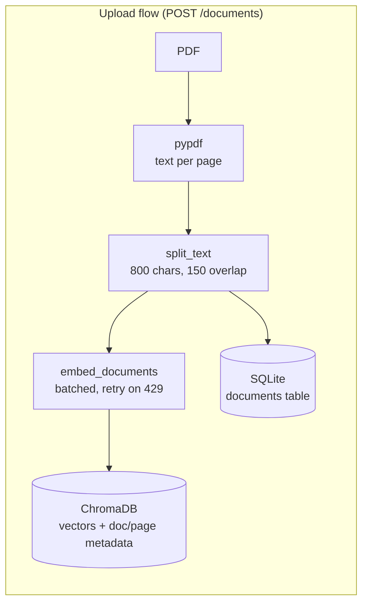
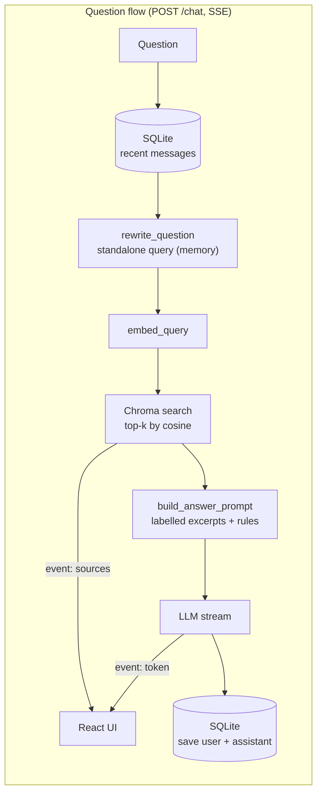

# Policy Document Assistant

Upload policy and research PDFs (for example UN or INTERPOL crime and cybercrime reports) and ask questions in a chat. The assistant answers **only from the uploaded documents**, cites every fact as `[Document name, p. X]`, and says so when the answer isn't in the documents instead of making something up. It remembers the conversation, so follow-ups like *"What about 2023?"* work. The backend is a hand-built RAG pipeline in Python/FastAPI: pypdf for parsing, Gemini or Ollama for embeddings and chat, ChromaDB for vectors, SQLite for memory. Answers stream token by token to a React/TypeScript frontend.

## Architecture





The LLM sits behind one interface (`app/llm/base.py::LLMProvider`) with two implementations, `GeminiProvider` and `OllamaProvider`, selected by `LLM_PROVIDER`.

## Tech stack

| Layer | Choice |
|---|---|
| API | Python 3.11+, FastAPI, Pydantic, uvicorn |
| PDF parsing | pypdf |
| Embeddings + chat | Google Gemini via `google-genai` (default) or Ollama (local) |
| Vector store | ChromaDB (persistent, local folder) |
| Memory + document registry | SQLite (stdlib `sqlite3`) |
| Frontend | React 19, TypeScript, Vite, Tailwind CSS v4 |
| Tests | pytest with a fake provider (no API key needed) |

## Setup

Requirements: Python 3.11+ and Node 20+.

### 1. Backend with Gemini (default)

```bash
cd backend
python3 -m venv .venv
source .venv/bin/activate
pip install -r requirements.txt
cp .env.example .env
# edit .env and set GEMINI_API_KEY (free key: https://aistudio.google.com/apikey)
uvicorn app.main:app --reload --port 8000
```

Check it's up: `curl localhost:8000/health`. Interactive API docs: http://localhost:8000/docs.

The default models are `gemini-3.5-flash-lite` for chat and `gemini-embedding-2` (768 dimensions) for embeddings. Change them in `.env` (`GEMINI_CHAT_MODEL`, `GEMINI_EMBED_MODEL`, `GEMINI_EMBED_DIM`); see the [Gemini models page](https://ai.google.dev/gemini-api/docs/models) for current names.

> On an Intel Mac, if pip starts compiling Rust code, run `pip install --only-binary :all: -r requirements.txt` to force prebuilt wheels.

### 1b. Backend with Ollama (fully local, no key)

```bash
ollama pull llama3.2
ollama pull nomic-embed-text
# in backend/.env:
LLM_PROVIDER=ollama
```

Then start uvicorn as above. Ollama must be running (`ollama serve`, or the desktop app).

> **Switching providers:** embeddings from different models can't be compared. The app records which embedding model built the index. If you switch while documents exist, `/health` and the UI show a warning, and upload/chat return 409 until you switch back or delete and re-upload the documents.

### 2. Frontend

```bash
cd frontend
npm install
cp .env.example .env    # VITE_API_URL=http://localhost:8000
npm run dev             # http://localhost:5173
```

### 3. Tests

```bash
cd backend
source .venv/bin/activate
pytest
```

The tests swap in a `FakeProvider` (bag-of-words embeddings, canned answer), so they need no network or key. They build tiny PDFs in memory.

## API

| Method | Path | Description |
|---|---|---|
| `POST` | `/documents` | Multipart upload (`file`). Returns `{id, name, pages, chunks}`. 400 for a non-PDF, broken or text-less PDF; 413 if over `MAX_UPLOAD_MB`. |
| `GET` | `/documents` | List uploaded documents. |
| `DELETE` | `/documents/{id}` | Delete a document and its chunks. 204, or 404 if unknown. |
| `POST` | `/chat` | Body `{session_id, question}`. Responds with `text/event-stream` (see below). |
| `GET` | `/sessions/{id}/messages` | Chat history, oldest first, with each answer's sources. |
| `GET` | `/health` | Active provider, chat and embedding models, config errors, index warning, document count. |

`/chat` SSE events, in order:

```
event: question   data: {"standalone": "What were cybercrime trends in 2023?"}
event: token      data: {"text": "Phishing "}        (repeated)
event: sources    data: {"sources": [{"document", "document_id", "page", "text", "score"}]}
event: done       data: {}
```

If something fails after streaming has started, the server sends `event: error` with `{message, status}`. Errors before streaming (for example a missing API key) are normal JSON responses.

| Status | Meaning |
|---|---|
| 400 | Bad file type, unreadable or empty PDF |
| 409 | Embedding model changed since documents were indexed |
| 422 | Invalid request body |
| 429 | Provider rate limit still hit after retrying (waits as long as the provider asks, up to 6 attempts for Gemini) |
| 502 | Other provider error |
| 503 | Provider not configured (missing key, Ollama not running) |

## Design decisions

- **Chunk size 800 characters, overlap 150.** About 150–200 tokens: big enough to hold a full statistic with its context, small enough that the top-5 excerpts fit easily in the prompt and each is focused on one topic. The overlap means a sentence cut at a chunk boundary still appears whole in the neighbouring chunk. Chunks break at sentence or word boundaries where possible.
- **Chunk per page.** Chunks never cross a page boundary, so every chunk has exactly one page number and citations are exact. The cost is that a sentence spanning two pages is split.
- **Top-k = 5.** Enough to cover an answer that draws on several sections, few enough to keep the prompt short (cheaper, faster, less noise for the model). Configurable with `TOP_K`.
- **Cosine similarity.** Chroma is created with `hnsw:space=cosine`. The UI shows `1 - distance` as a similarity score.
- **Asymmetric embeddings.** Documents and queries are embedded with different task prefixes (`title: … | text:` vs `task: search result | query:` for Gemini, `search_document:` vs `search_query:` for nomic), which is what both models are trained for.
- **Question rewriting for memory.** Embedding "What about 2023?" retrieves nothing useful. One small LLM call first rewrites it into a standalone question using the last 6 messages. That call is skipped on the first message of a chat.
- **Grounded prompt with labelled excerpts.** Each excerpt is headed with its exact citation, `--- [name.pdf, p. X] ---`, so the model only has to copy it (an earlier version numbered the excerpts and small models cited `[1]` instead), and the system prompt requires a citation after every fact and a fixed "not found" sentence otherwise. Temperature is 0.2. Citations let users check every claim, which matters more than fluency for policy documents. Sources are attached only when the answer actually contains a citation, so a "not found" reply or a reply to "hi" never presents unrelated chunks as evidence. Greetings and thanks get a short friendly reply naming the uploaded documents, but factual questions are never answered from outside knowledge (e.g. "what is the capital of France?" is refused).
- **Provider abstraction.** `LLMProvider` has four methods (`embed_documents`, `embed_query`, `generate`, `stream`). The RAG code never imports a vendor SDK, so adding OpenAI or Claude means one new class. Tests use the same interface with a fake.
- **Free-tier friendly.** Embeddings go out in batches of 50 chunks per request. Note that Gemini's free tier counts *each chunk* as a request (about 100 per minute for `gemini-embedding-2`), so batching saves round trips but not quota. On a 429 we wait for the `retryDelay` Gemini returns (e.g. 18s) and try again, up to 6 times; otherwise exponential backoff (2s, 4s, 8s…). If retries run out, the UI shows a clear rate-limit message. In testing, the 36-page INTERPOL report (179 chunks) indexed in about 40 seconds.
- **No LangChain/LlamaIndex.** Each step is a short, readable function, which makes the pipeline easy to explain and debug.

## Limitations

- Scanned (image-only) PDFs have no text layer and are rejected; there's no OCR.
- Tables and multi-column layouts come out of pypdf as flat text, so figures in tables can lose their row and column labels.
- Pure vector search can miss exact terms such as acronyms or report codes (see hybrid search below).
- A single local Chroma folder and SQLite file: fine for one user, not for many concurrent users or multiple server instances.
- No authentication: anyone with the URL can upload, delete and read any session's history.
- Uploads are processed synchronously, so a 300-page report keeps the request open while it embeds.

## Future improvements

- **pgvector** (Postgres) to keep vectors, documents and chat history in one managed database, which makes hosting easier.
- **Hybrid search**: BM25 keyword scores combined with vector scores (reciprocal rank fusion), then a reranker on the top 20.
- **Evaluation**: a small set of question/answer/page triples, measuring retrieval hit-rate@k and answer faithfulness (e.g. with Ragas), run in CI.
- **Multilingual support**: Gemini embeddings are multilingual, so this mostly means prompt changes and tests with French/Spanish UN reports.
- Background ingestion with progress, OCR for scanned PDFs, table-aware parsing, auth and per-user document spaces, citation links that open the PDF at the cited page.

## Deployment

**Backend on Render** (Railway is almost the same):

1. New → Web Service → connect the GitHub repo, root directory `backend`.
2. Build command: `pip install -r requirements.txt`
3. Start command: `uvicorn app.main:app --host 0.0.0.0 --port $PORT`
4. Environment: `LLM_PROVIDER=gemini`, `GEMINI_API_KEY=…`, `CORS_ORIGINS=https://<your-app>.vercel.app`, `PYTHON_VERSION=3.12.7`.
5. Chroma and SQLite write to `DATA_DIR`. Render's free instances have an **ephemeral filesystem**: uploads disappear on redeploy or restart. For a demo that's fine (re-upload). To keep data, add a persistent disk (paid) mounted at e.g. `/var/data` and set `DATA_DIR=/var/data`. On Railway, attach a Volume and point `DATA_DIR` at it.
6. Free instances sleep when idle, so the first request after a while takes ~30–60s.

Ollama isn't practical on these hosts, so deploy with Gemini.

**Frontend on Vercel:**

1. New Project → import the repo, root directory `frontend`, framework preset Vite.
2. Environment variable `VITE_API_URL=https://<your-backend>.onrender.com`.
3. Deploy, then make sure the Vercel URL is in the backend's `CORS_ORIGINS`.

## Demo documents

These are public reports; download them yourself (they aren't included in the repo):

1. **INTERPOL, Africa Cyberthreat Assessment Report 2025** (~1.4 MB): https://www.interpol.int/content/download/23094/file/INTERPOL_Africa_Cyberthreat_Assessment_Report_2025.pdf
2. **UNODC, Emerging threats: AI and automation in the cybercrime landscape of Southeast Asia** (2025): https://www.unodc.org/roseap/uploads/documents/Publications/2025/UNODC_Report_Emerging_threats_-_The_intersection_of_criminal_and_technological_innovation_in_the_use_of_automation_and_AI.pdf
3. **UNODC, The Nexus Between Cybercrime and Corruption** (2025): https://www.unodc.org/roseap/uploads/documents/Publications/2025/2025.10.21_The_Nexus_Between_Cybercrime_and_Corruption.pdf

More: [INTERPOL publications](https://www.interpol.int/en/Resources/Documents) and [UNODC Southeast Asia publications](https://www.unodc.org/roseap/en/resources/publications.html).

Tip: for a quick demo, start with a report under ~100 pages. A 300-page report is roughly 1,000 chunks, which at ~100 chunks per minute on the free tier takes about 10 minutes to index.

Good demo questions: *"What are the main trends in cyber-enabled fraud?"* → *"What about in West Africa?"* (follow-up), and *"Who won the 2022 World Cup?"* (shows the not-found behaviour).
